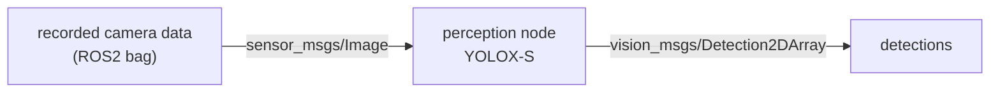

# ros2-jetson-perception

> **Work in progress.** The design is fixed; the code arrives step by step.

One pretrained object detector (YOLOX-S) taken through three settings:

1. **A ROS2 perception node** that subscribes to camera images and publishes detections, in Python and in C++.
2. **The same node on an NVIDIA Jetson**, optimised with TensorRT (FP32, FP16, INT8) and measured.
3. **A containerised inference service on Kubernetes**, with CI/CD.



## Target platforms

| | Development | Edge device |
|---|---|---|
| Hardware | Apple Silicon Mac (arm64) | NVIDIA Jetson Xavier NX, 8 GB |
| Software | ROS2 Humble in Docker | JetPack 4.6.2 (TensorRT 8.2.1), ROS2 Humble in Docker |
| Inference | ONNX Runtime (CPU) | TensorRT |

Everything runs in containers. The edge code stays compatible with the Python 3.6 that ships with JetPack 4.6.

## Status

| Part | State |
|---|---|
| ROS2 perception node (Python, C++) | in progress |
| Jetson deployment and TensorRT benchmarks | planned |
| Kubernetes service and CI/CD | planned |

## Planned layout

```
model/        model export and shared pre/post-processing
ros2_ws/src/  ROS2 packages: video source, Python and C++ nodes, launch files
jetson/       Jetson container, engine builds, benchmarks
service/      HTTP inference service
k8s/          Kubernetes manifests
```

## License

[Apache-2.0](LICENSE)
