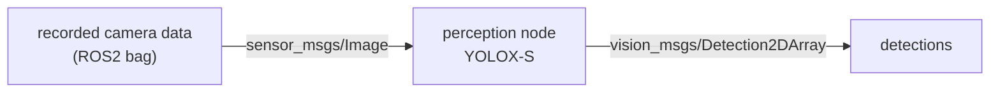
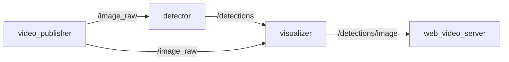

# ros2-jetson-perception

> **Work in progress.** The design is fixed; the code arrives step by step.

One pretrained object detector (YOLOX-S) taken through three settings:

1. **A ROS2 perception node** that subscribes to camera images and publishes detections, in Python and in C++.
2. **The same node on an NVIDIA Jetson**, optimised with TensorRT (FP32, FP16, INT8) and measured.
3. **A containerised inference service on Kubernetes**, with CI/CD.



## Target platforms

| | Development | Edge device |
|---|---|---|
| Hardware | Apple Silicon Mac (arm64) | NVIDIA Jetson Xavier NX, 8 GB |
| Software | ROS2 Humble in Docker | JetPack 4.6.2 (TensorRT 8.2.1), ROS2 Humble in Docker |
| Inference | ONNX Runtime (CPU) | TensorRT |

Everything runs in containers. The edge code stays compatible with the Python 3.6 that ships with JetPack 4.6.

## Status

| Part | State |
|---|---|
| Video source: a video file played as a camera | done |
| YOLOX-S export to ONNX, pre/post-processing | done |
| ROS2 perception node in Python, live view in the browser | done |
| ROS2 perception node in C++ | planned |
| Jetson deployment and TensorRT benchmarks | planned |
| Kubernetes service and CI/CD | planned |

## Usage (so far)

All commands run from the repository root.

**1. Export the model to ONNX.** A one-off tool image with PyTorch and YOLOX downloads the weights and converts them:

```bash
docker build -t yolox-export model/
docker run --rm -v "$PWD":/project yolox-export /project/model/export.sh s /project/models
```

`s` can be `nano`, `s` or `m`. The result is `models/yolox_s.onnx` (input `1×3×640×640`, output `1×8400×85`).

**2. Build the development image and the workspace.** ROS2 Humble plus ONNX Runtime, `vision_msgs` and `web_video_server`:

```bash
docker build -t ros2-perception-dev ros2_ws/
docker run -it --rm -p 127.0.0.1:8080:8080 -v "$PWD":/project -w /project/ros2_ws ros2-perception-dev bash
colcon build --symlink-install
source install/setup.bash
```

**3. Run the demo.** One launch file starts the video source, the detector, the visualizer and a web server for the live view:

```bash
ros2 launch perception_py demo.launch.py video:=/project/my_clip.mp4
```

Watch the result at http://localhost:8080/stream_viewer?topic=/detections/image



| Node | Package | Does |
|---|---|---|
| `video_publisher` | `video_source` | Plays a video file as a camera: `sensor_msgs/Image` on `/image_raw`, looping |
| `detector` | `perception_py` | Letterbox to 640×640 → YOLOX (ONNX Runtime) → decode + per-class NMS → `vision_msgs/Detection2DArray` on `/detections`; logs the average time per frame |
| `visualizer` | `perception_py` | Pairs each frame with its detections by timestamp and draws the boxes on `/detections/image` |
| `web_video_server` | ROS2 | Serves image topics to the browser |

| Launch argument | Default | Meaning |
|---|---|---|
| `video` | none (required) | Video file to play |
| `scale` | `1.0` | Resize factor for the video frames, e.g. `0.5` |
| `model` | `/project/models/yolox_s.onnx` | ONNX model |

**Record the camera topic as a ROS2 bag**, a replayable recording. Raw frames are large: about 45 MiB per second at 960×540.

```bash
ros2 run video_source video_publisher --ros-args -p video_path:=/project/my_clip.mp4 -p scale:=0.5
ros2 bag record -o /project/bags/my_clip /image_raw   # in a second terminal; stop with Ctrl+C
ros2 bag play /project/bags/my_clip
```

**Check detection on one image**, without ROS2. Writes `models/boxes.png`:

```bash
docker run --rm -v "$PWD":/project -w /project/models yolox-export python /project/model/check_detect.py
```

## Layout

```
model/        model export, single-image check
ros2_ws/      development Dockerfile; src/: ROS2 packages (video source, Python and C++ nodes, launch files)
jetson/       Jetson container, engine builds, benchmarks
service/      HTTP inference service
k8s/          Kubernetes manifests
```

## License

[Apache-2.0](LICENSE)
