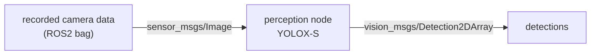

# ros2-jetson-perception

> **Work in progress.** The design is fixed; the code arrives step by step.

One pretrained object detector (YOLOX-S) taken through three settings:

1. **A ROS2 perception node** that subscribes to camera images and publishes detections, in Python and in C++.
2. **The same node on an NVIDIA Jetson**, optimised with TensorRT (FP32, FP16, INT8) and measured.
3. **A containerised inference service on Kubernetes**, with CI/CD.



## Target platforms

| | Development | Edge device |
|---|---|---|
| Hardware | Apple Silicon Mac (arm64) | NVIDIA Jetson Xavier NX, 8 GB |
| Software | ROS2 Humble in Docker | JetPack 4.6.2 (TensorRT 8.2.1), ROS2 Humble in Docker |
| Inference | ONNX Runtime (CPU) | TensorRT |

Everything runs in containers. The edge code stays compatible with the Python 3.6 that ships with JetPack 4.6.

## Status

| Part | State |
|---|---|
| Video source: a video file played as a camera | done |
| YOLOX-S export to ONNX, pre/post-processing | done |
| ROS2 perception node (Python, C++) | in progress |
| Jetson deployment and TensorRT benchmarks | planned |
| Kubernetes service and CI/CD | planned |

## Usage (so far)

Everything runs in the official ROS2 Humble container, from the repository root:

```bash
docker run -it --rm -v "$PWD":/project -w /project/ros2_ws ros:humble-perception bash
colcon build --symlink-install
source install/setup.bash
```

**Play a video file as a camera.** Publishes `sensor_msgs/Image` on `/image_raw` at the video's frame rate, looping at the end:

```bash
ros2 run video_source video_publisher --ros-args -p video_path:=/project/my_clip.mp4 -p scale:=0.5
```

| Parameter | Default | Meaning |
|---|---|---|
| `video_path` | none (required) | Video file to play |
| `scale` | `1.0` | Resize factor for width and height, e.g. `0.5` for half size |

**Record it as a ROS2 bag**, a replayable recording of the topic. Raw frames are large: about 45 MiB per second at 960×540.

```bash
ros2 bag record -o /project/bags/my_clip /image_raw   # stop with Ctrl+C
ros2 bag info /project/bags/my_clip
ros2 bag play /project/bags/my_clip
```

**Export the model to ONNX.** A one-off tool image with PyTorch and YOLOX downloads the weights and converts them:

```bash
docker build -t yolox-export model/
docker run --rm -v "$PWD":/project yolox-export /project/model/export.sh s /project/models
```

`s` can be `nano`, `s` or `m`. The result is `models/yolox_s.onnx` (input `1×3×640×640`, output `1×8400×85`).

**Check detection on one image.** Pre-processing, the ONNX model and post-processing in plain Python; writes `models/boxes.png`:

```bash
docker run --rm -v "$PWD":/project -w /project/models yolox-export python /project/model/check_detect.py
```

## Planned layout

```
model/        model export and shared pre/post-processing
ros2_ws/src/  ROS2 packages: video source, Python and C++ nodes, launch files
jetson/       Jetson container, engine builds, benchmarks
service/      HTTP inference service
k8s/          Kubernetes manifests
```

## License

[Apache-2.0](LICENSE)
